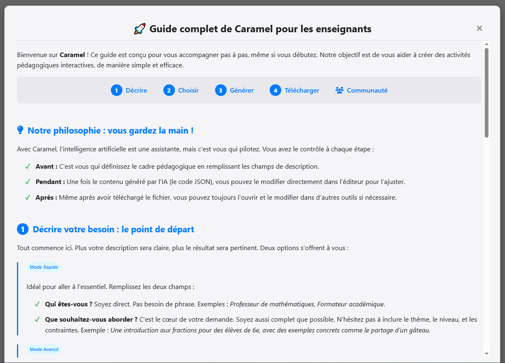

# 🍬 Caramel — Guide complet pour enseignants

**Création Assistée de Ressources et d'Activités Magistère et Éléa**

---

> ✨ **Notre philosophie : Vous gardez toujours la main !**
>
> Avec **Caramel**, l'intelligence artificielle est votre **assistante pédagogique**, pas votre remplaçante :
> - **Avant** : C'est **vous** qui définissez le cadre pédagogique (discipline, niveau, objectifs)
> - **Pendant** : Une fois le contenu généré, **vous** pouvez le modifier et l'ajuster directement
> - **Après** : Même après téléchargement, **vous** restez libre de modifier le fichier à tout moment
>
> 🔒 **Vos données sont protégées de bout en bout :**
> - **Vos documents restent sur votre ordinateur** : l'extraction de texte (PDF, images) se fait dans votre navigateur, rien n'est envoyé à un serveur.
> - **Les IA intégrées sont hébergées en France** : vos requêtes transitent par des serveurs universitaires mutualisés (projet [ILaaS](https://www.ilaas.fr/)) qui ne collectent ni ne revendent vos données.
> - **Seul le copier-coller vers une IA externe vous engage** : si vous utilisez un service tiers, la protection dépend de ses conditions.
>
> 🎯 **L'IA propose, l'enseignant dispose !**

---

**Caramel** est une application **gratuite**, **sans inscription** et **sans publicité**, créée par des enseignants pour des enseignants. Elle vous permet de créer en quelques minutes des activités pédagogiques interactives qui vous prendraient des heures à concevoir manuellement.

> 🌍 **Ouverte sur le monde** : Caramel est déjà disponible en **11 langues** pour accompagner les enseignants partout dans le monde.

| Ce que vous pouvez créer | Temps de création |
|--------------------------|-------------------|
| 🎯 **Quiz interactifs** (QCM, vrai/faux, question sets...) | ⏱️ **Moins de 5 minutes** |
| 📝 **Exercices de texte** (textes à trous, mots à glisser...) | de la description |
| 🧠 **Outils de mémorisation** (flashcards, frises chronologiques...) | à l'intégration |
| 🎮 **Activités ludiques** (mots croisés, millionnaire, mots mêlés...) | dans votre cours ! |
| 📚 **Ressources de cours** (pages Éléa, livres, glossaires, accordéons...) | |
| 🎬 **Contenus interactifs riches** (vidéo interactive, livre interactif, présentations...) | |

---

## 🚀 Guide rapide : Les 4 étapes

```
1️⃣ DÉCRIRE  →  2️⃣ CHOISIR  →  3️⃣ GÉNÉRER  →  4️⃣ IMPORTER
```

---

## 🤖 Caramelia, l'assistante qui vous prend par la main

> 💡 **Vous débutez avec Caramel ?** Cliquez simplement sur la **bulle de chat** en bas à droite : **Caramelia** se charge du reste.

**Caramelia** est votre assistante intégrée. Plutôt que de remplir vous-même les champs « Qui êtes-vous ? », « Que souhaitez-vous aborder ? », de choisir la bonne tuile et de cliquer sur les bons boutons, **dites-lui simplement ce que vous voulez faire** — en langage naturel — et elle pilote l'interface Caramel à votre place.

### Exemples de demandes

| Vous tapez… | Caramelia… |
|-------------|------------|
| `Je veux un quiz sur les fractions pour des 6e, 10 questions` | …remplit les champs, ouvre la tuile **Quiz mixte** et lance la génération |
| `Une frise sur la Révolution française, niveau 4e` | …choisit la tuile **Timeline**, paramètre la discipline et le niveau |
| `Comment je fais pour importer un .h5p dans Éléa ?` | …répond directement dans la conversation (mode aide) |

### Ce qu'elle sait faire

- 🧠 **Comprend votre intention** : elle distingue toute seule une demande d'activité (« je veux faire… ») d'une question d'aide (« comment je fais pour… »)
- ✏️ **Remplit les champs à votre place** : Qui êtes-vous ?, Que souhaitez-vous aborder ?, niveau, nombre d'éléments
- 🎯 **Choisit la bonne tuile** parmi les 31 activités disponibles
- 📎 **Accepte les pièces jointes** : glissez un PDF ou un document directement dans la conversation, elle l'utilise comme support pour la génération (RAG)
- 🌍 **Parle vos 11 langues** : elle s'aligne automatiquement sur la langue choisie dans Caramel
- ♿ **Accessible au clavier** : navigation complète sans souris, focus restauré à la fermeture

### Ce qu'elle ne fait *pas*

- ❌ **Elle ne crée pas d'activités elle-même** : tout passe par le moteur Caramel habituel (votre IA souveraine ILaaS, le packaging local, etc.)
- ❌ **Elle ne stocke rien** : aucune conversation n'est enregistrée ailleurs que dans votre navigateur
- ❌ **Elle ne remplace pas vos décisions pédagogiques** : elle propose, vous validez avant la génération

> 🎯 **L'idée** : passer de 10 minutes à comprendre l'interface, à 30 secondes pour décrire ce que vous voulez. La pédagogie reste à vous, la mécanique est à Caramelia.

---

# 1️⃣ Démarrer avec Caramel

Avant de créer une activité, indiquez à Caramel **ce que vous souhaitez enseigner**.

<details>
<summary><strong>🎯 Mode Rapide (recommandé pour débuter)</strong></summary>

Le **Mode Rapide** vous pose seulement 2 questions :

### 🔹 Qui êtes-vous ?

Décrivez votre rôle et contexte d'enseignement. Cela permet à l'IA d'adapter son ton et son expertise.

**Exemples :**
- `Professeur de mathématiques en lycée`
- `Formateur académique en sciences`
- `Enseignant d'histoire-géographie en collège`

### 🔹 Que souhaitez-vous aborder ?

Décrivez le sujet, le niveau et vos attentes de manière fluide.

**Exemples :**
- `Introduction aux fractions en 6e`
- `La Révolution française pour des élèves de 4e, focus sur 1789`
- `Les accords du participe passé en 3e`


> 💡 **Astuce** : Les tuiles sont désormais **intelligentes** ! Elles restent grisées tant que vous n'avez pas commencé à remplir les champs, pour vous guider dans les étapes essentielles.

</details>

<details>
<summary><strong>🎓 Mode Avancé (pour plus de contrôle)</strong></summary>

Le **Mode Avancé** vous offre un contrôle précis sur chaque paramètre grâce à **4 champs distincts** qui structurent parfaitement votre demande pour l'IA :

| Paramètre | Description | Exemples |
|-----------|-------------|----------|
| **Discipline** | La matière enseignée | Mathématiques, Histoire, Français, SVT... |
| **Thème** | Le sujet spécifique | Théorème de Pythagore, Révolution française... |
| **Niveau** | Niveau scolaire | `6e`, `4e`, `2nde`, `Terminale`, `CAP 1ère année`, `Licence 1`... |
| **Nombre d'éléments** ⚠️ | **TRÈS IMPORTANT !** | Quiz → questions, Frise → événements, Glossaire → termes |

> 💡 **Astuce** : Commencez petit (5-10 éléments) pour tester, puis augmentez !


</details>

<details>
<summary><strong>📄 Consultation de document (RAG) — Fonctionnalité avancée</strong></summary>

Cette fonctionnalité vous permet de **donner un document de référence** à l'IA pour qu'elle génère des contenus basés sur **vos propres supports de cours**.

### Comment ça marche ?

1. Rendez-vous dans la zone **"Joindre des documents (facultatif)"**
2. Plusieurs options :
   - **📋 Coller du texte** : Ctrl+V pour coller un extrait de cours
   - **📁 Téléverser un fichier** : Glissez-déposez votre document, image, audio ou vidéo
   - **🔗 Importer une page web** : Collez un lien dans le champ prévu, Caramel récupère le texte de la page

> 🚀 **OCR Universel** : Caramel supporte de nombreux formats de documents : **PDF**, **DOCX**, **PPTX**, **ODT**, **ODP** ainsi que les images **PNG**, **JPG** et **JPEG** (via reconnaissance de caractères).
>
> 🎙️ **Son et vidéo** : Caramel peut aussi **transcrire** un fichier **audio** (MP3, M4A, WAV, OGG, FLAC) ou la **bande-son d'une vidéo** (MP4, MOV, WEBM) — jusqu'à **90 minutes**. Le texte transcrit rejoint la zone de contexte comme n'importe quel document (voir la note de confidentialité ci-dessous).

### Cas d'usage concrets

| Profil | Action | Résultat |
|--------|--------|----------|
| 📚 **Enseignant de SVT** | Téléverse le PDF d'un chapitre sur la photosynthèse | 15 questions de quiz ciblées sur ce contenu |
| 📚 **Professeur d'histoire** | Téléverse une photo d'un manuel scolaire | Chronologie extraite automatiquement de l'image |
| 📚 **Formatrice** | Téléverse son support PowerPoint (`.pptx`) | Glossaire des termes techniques du cours |
| 🎙️ **Professeur de langues** | Dépose un fichier audio (ou la bande-son d'une vidéo) | Transcription puis quiz de compréhension orale |
| 🔗 **Documentaliste** | Colle le lien d'une fiche Éduscol | Activité basée sur le texte de la page |

> 🔐 **Confidentialité** : L'extraction de texte des **documents** (PDF, DOCX, images via OCR…) et des **pages web** se fait **dans votre navigateur** ou via un proxy qui ne conserve rien. **Exception : la voix** (dictée au micro, fichier audio ou bande-son d'une vidéo) est transmise le temps de sa transcription à **Albert**, le service de transcription souverain de la **DINUM** hébergé en France (basé sur Whisper) ; l'audio n'est pas conservé.

### Limites techniques

- 📏 **120 000 caractères maximum** (environ 50 pages)
- 📄 **Documents** : PDF, DOCX, PPTX, ODT, ODP, PNG, JPG, JPEG (avec ou sans OCR), texte brut
- 🎙️ **Audio** : MP3, M4A, WAV, OGG, FLAC (transcrits automatiquement, jusqu'à 90 min — voir la note de confidentialité ci-dessus)
- 🎬 **Vidéo** : MP4, MOV, WEBM (seule la **bande-son** est extraite puis transcrite, jusqu'à 90 min)
- 🔗 **Page web** : un lien `http(s)://` (le texte de la page est récupéré ; pas de parcours du site)
- ⚡ **Performance** : Les gros PDF peuvent prendre quelques secondes à traiter ; un fichier audio ou vidéo long est découpé en lots et transcrit progressivement

</details>

---

# 2️⃣ Types d'activités disponibles

Une fois votre contexte pédagogique défini, cliquez sur l'activité qui correspond à votre objectif.


### 🧩 La barre de filtres

Les activités se trient selon **deux axes complémentaires** : par **type pédagogique** et par **plateforme de destination**. Combinez-les pour ne voir que ce qui vous intéresse.

**Par type d'activité :**

| Filtre | Contenu |
|--------|---------|
| **📂 Tout** | Affiche les 31 activités en un seul écran |
| **🎯 Quiz & Tests** | Quiz mixte, Quiz QCM, Quiz Vrai/Faux, Vrai/Faux, Choix multiples, Single Choice Set, Présentation de cours, Vidéo interactive, Livre interactif, Test, Millionnaire, Appariement, QCM, Devoir |
| **✏️ Manipulation de texte** | Textes à trous, Glisser les mots, Glisser-déposer, Marquer les mots, Trier les paragraphes, Rédaction, Résumé, Présentation de cours, Livre interactif |
| **🧠 Mémorisation & Découverte** | Flashcards, Frises, Glossaires/Accordéons, Mots croisés, Mots mêlés, Graphiques, Cartes de dialogue |

**Par plateforme :**

| Filtre | Contenu |
|--------|---------|
| **🔷 H5P** | Toutes les activités exportables au format `.h5p` (universelles) |
| **🎓 Éléa** | Pages, Livre, Devoir, Test, QCM, Appariement, Millionnaire, Glossaire |
| **🏛️ Magistère** | Les activités compatibles avec Magistère |
| **🟧 Moodle** | Les activités compatibles avec Moodle |

> 💡 La **Vidéo interactive** et le **Livre interactif** sont des activités H5P comme les autres : on les retrouve naturellement dans les filtres ci-dessus selon leur usage pédagogique.

<details>
<summary><strong>🎯 Activités H5P (fichiers <code>.h5p</code>)</strong></summary>

Les fichiers **H5P** sont des modules interactifs universels, compatibles avec Moodle, Éléa, Magistère et même des sites web classiques.

### Quiz et évaluations

| Activité | Description | Cas d'usage |
|----------|-------------|-------------|
| **Quiz mixte** | Ensemble varié de questions (QCM, V/F, glisser-déposer,...) | Évaluation complète avec plusieurs types de questions |
| **Quiz QCM** | Question à choix multiples via Quizset | Création ultra-rapide d'évaluation ciblée |
| **Quiz Vrai/Faux** | Question affirmation vrai ou faux via Quizset | Vérification flash d'une connaissance |
| **Single Choice Set** | Série de questions à choix unique | Quiz rapide style "cartes flash" |
| **Vidéo interactive** | À partir d'un **lien vidéo**, l'IA récupère la transcription et place des questions (QCM, Vrai/Faux, texte à trous) aux moments clés, avec un résumé final | Capsule vidéo enrichie, classe inversée, vérification de compréhension |

> 💡 **Information** : Les activités Quiz QCM et Quiz Vrai/Faux utilisent le moteur **Quizset** pour une génération fiable et rapide.

> 🎬 **Vidéo interactive — comment ça marche ?** Collez le lien d'une vidéo (**Tubes Apps Éducation**, **PodEduc** ou **YouTube**), cliquez sur **« Récupérer la transcription »**, puis générez : l'IA insère les questions là où une nouvelle idée commence. Un voyant indique l'état (🟢 prête · 🟡 à générer · 🟠 collage manuel · 🔴 non lisible). La vidéo n'est **jamais embarquée** dans le fichier (seul son lien est conservé). Si la détection échoue, vous pouvez **coller vous-même** une transcription (WebVTT, SRT ou texte brut).

### Manipulation de texte

| Activité | Description | Cas d'usage |
|----------|-------------|-------------|
| **Glisser les mots** | Déplacer des mots pour compléter un texte | Exercice de vocabulaire, syntaxe |
| **Texte à trous** | Compléter les mots manquants par saisie | Exercice de complétion classique |
| **Marquer les mots** | Cliquer sur les mots corrects dans un texte | Repérage de mots-clés, analyse |
| **Trier des paragraphes** | Remettre des paragraphes dans l'ordre | Reconstitution de texte, chronologie |
| **Glisser-déposer (Drag & Drop)** | Déplacer des étiquettes dans des zones dédiées | Associations spatiales, étiquetage d'images, tris thématiques |

### Mémorisation et révision

| Activité | Description | Cas d'usage |
|----------|-------------|-------------|
| **Flashcards** | Cartes mémoire recto-verso | Révision de vocabulaire, formules |
| **Frise chronologique** | Ligne du temps interactive | Histoire, sciences, chronologie |
| **Accordéon / Glossaire** | Définitions déroulantes | Lexique, FAQ, ressources |
| **Cartes de dialogue** | Questions-réponses en cartes | Révision active, entraînement |

### Activités ludiques

| Activité | Description | Cas d'usage |
|----------|-------------|-------------|
| **Mots croisés** | Grille de mots croisés automatique | Révision ludique de vocabulaire |
| **Mots mêlés** | Grille de recherche de mots cachés | Découverte de termes, échauffement |
| **Rédaction (Essay)** | Production écrite avec grille de mots-clés | Évaluation de rédaction semi-automatisée |
| **Résumé** | Création de résumés interactifs | Synthèse de cours, révision |
| **Graphiques (Chart)** | Diagrammes et graphiques visuels | Données statistiques, sciences |

### Cours et présentations interactifs

| Activité | Description | Cas d'usage |
|----------|-------------|-------------|
| **Présentation de cours** | Diaporama interactif multi-diapositives avec exercices intégrés | Cours structuré, séquence pédagogique, diaporama interactif |
| **Livre interactif** | Livre numérique **multi-chapitres** : chaque page mêle textes, tableaux, images **et exercices** (QCM, Vrai/Faux, texte à trous…), avec table des matières et page de résumé | Chapitre de manuel, séquence complète, dossier documentaire auto-évalué |

> 📖 **Livre interactif vs Livre Éléa** : le **Livre interactif** (H5P) est autonome et embarque de vrais exercices auto-corrigés sur chaque page ; le **Livre** Éléa (`.mbz`, voir plus bas) est un cours multi-chapitres natif Moodle réutilisant les blocs de Page. Choisissez le premier pour un contenu interactif universel, le second pour une intégration profonde dans Éléa.

</details>

<details>
<summary><strong>🎓 Activités Éléa/Moodle (fichiers <code>.mbz</code>, <code>.xml</code>, <code>.html</code>)</strong></summary>

Les activités **Éléa/Moodle** sont des modules natifs optimisés pour les plateformes Moodle, Éléa et Magistère.

| Activité | Format | Description |
|----------|--------|-------------|
| **Page** | `.mbz` ou `.html` | Page de cours riche avec 18 types de blocs (texte, image, vidéo, citation...) |
| **Livre** | `.mbz` | Cours pédagogique **multi-chapitres** réutilisant les 18 blocs de Page, avec table des matières automatique, sous-chapitres optionnels et numérotation décimale |
| **Test / Banque** | `.xml` ou `.gift` | Questions pour banque Moodle (format universel) |
| **QCM (activité)** | `.mbz` | Quiz complet prêt à restaurer |
| **Appariement** | `.mbz` | Associer des paires (questions ↔ réponses) |
| **Millionnaire** | `.mbz` | Jeu "Qui veut gagner des millions" pédagogique |
| **Glossaire** | `.mbz` | Dictionnaire de termes collaboratif |
| **Devoir** | `.mbz` | Création d'une grille d'évaluation critériée et niveaux de réussite au sein d'une activité Devoir |

### Quelle différence entre H5P et Éléa ?

> 💡 **H5P** (`.h5p`) : Universel, léger, facile à partager entre plateformes
>
> 💡 **Éléa/Moodle** (`.mbz`) : Intégration native, fonctionnalités avancées (suivi, notes, feedback personnalisé)

</details>

---

# 3️⃣ Générer et affiner le contenu

Une fois votre activité choisie, une **fenêtre de génération** s'ouvre.

<details>
<summary><strong>🎯 Mode Simple : Générer en un clic (recommandé)</strong></summary>

Le **Mode Simple** automatise tout le processus grâce à l'intelligence artificielle.

### Comment ça marche ?

1. La fenêtre affiche un **résumé de votre demande**
2. Sélectionnez le **modèle d'IA** souhaité dans le menu déroulant
3. Cliquez sur **"Générer avec l'IA"**
4. ⏳ Patientez quelques secondes (10-30 secondes selon la complexité)
5. ✅ Le contenu apparaît automatiquement dans l'éditeur JSON


### Après la génération : Modale post-génération

Une fois l'IA a fini de générer, **une modale contextuelle apparaît** avec **trois actions possibles** :

| Action | Description |
|--------|-------------|
| **📥 Télécharger** | Accès direct au fichier généré (H5P, MBZ, XML, etc.). Le fichier se télécharge immédiatement dans vos téléchargements. |
| **👁️ Visualiser et éditer** | Prévisualisation en direct de l'activité avec possibilité d'**éditer le contenu** (questions, réponses, termes, etc.) avant téléchargement. Les modifications sont appliquées instantanément au fichier final. |
| **➕ Continuer** | Ferme la modale pour générer rapidement une autre activité, sans quitter l'interface. Vos fichiers générés restent accessibles dans la **barre de notifications**. |

> 💡 **Astuce** : Cette modale vous fait gagner un temps précieux ! Vous pouvez générer plusieurs activités d'affilée sans interruption.

</details>

<details>
<summary><strong>🎓 Mode Guidé : Utiliser votre IA préférée (avancé)</strong></summary>

Le **Mode Guidé** vous permet d'utiliser n'importe quelle IA externe (ChatGPT, Claude, Gemini...) si vous avez un abonnement ou des préférences spécifiques.

### Comment ça marche ?

**1. Côté gauche : Le prompt détaillé**
- L'interface vous guide désormais avec **4 blocs distincts** pour compléter les informations nécessaires à la génération.
- Le **prompt** (instructions pour l'IA) se construit et s'affiche.
- Cliquez sur **"Copier le prompt"** (copié dans le presse-papiers).

**2. Dans votre IA externe :**
- Ouvrez votre IA préférée (ChatGPT, Claude, Gemini...)
- Collez le prompt avec **Ctrl+V** (ou **Cmd+V** sur Mac)
- Attendez la réponse de l'IA
- Copiez le **résultat JSON** généré

**3. Côté droit dans Caramel :**
- Cliquez dans la zone de droite et collez avec **Ctrl+V**
- Caramel valide automatiquement le JSON


### Outils pratiques

- 🔒 **Verrouiller** : Gèle le prompt pour éviter les modifications accidentelles
- 🖥️ **Plein écran** : Agrandit l'éditeur pour plus de confort
- 📋 **Copier** : Copie rapidement le prompt ou le JSON

> ⚠️ **Attention** : Ce mode nécessite de copier-coller entre deux fenêtres. Le Mode Simple est plus rapide et pratique !

</details>

<details>
<summary><strong>👁️ Visualisation, Édition et Exports</strong></summary>

Une fois votre activité générée, Caramel vous offre des outils pour gérer et affiner votre travail sans stress.

### 🎥 Visualisation en temps réel (Aperçu)
Un bouton **"Visualiser"** apparaît dans votre menu de notifications dès qu'une génération est prête.
- **Aperçu immédiat** : Voyez l'activité telle qu'elle sera dans Moodle/Éléa.
- **Historique** : Retrouvez vos dernières générations et visualisez-les à nouveau sans les régénérer.
- **Navigation** : Faites défiler vos créations vers la gauche ou la droite pour comparer.


### ✏️ Éditeur d'activités intégré
Dans la fenêtre de visualisation, vous pouvez désormais **modifier le contenu directement** sans quitter Caramel :

- **Questions et réponses** : Corrigez ou reformulez les questions générées par l'IA
- **Termes et définitions** : Adaptez le glossaire à votre vocabulaire
- **Niveaux de difficulté** : Réglez la progressivité du quiz à votre guise
- **Mises à jour en temps réel** : Les modifications sont immédiatement appliquées au fichier téléchargeable

#### 🔤 Éditeur de texte enrichi

L'éditeur intègre une **barre d'outils contextuelle** qui apparaît automatiquement sur les champs compatibles :

- **Mise en forme** : gras, italique, souligné, barré, exposant, indice
- **Couleur** du texte
- **Listes** à puces ou numérotées
- **Liens** vers des sites web
- **Bascule code source** : voir et modifier le texte brut à tout moment

> 💡 Seuls les champs qui supportent le format HTML affichent la barre d'outils. Les champs courts (titres, réponses) ont une version compacte.

#### √x Formules mathématiques

Un **assistant de formules** permet d'insérer des expressions LaTeX dans vos questions et réponses :

1. Cliquez sur le bouton **√x** dans la barre d'outils
2. Choisissez parmi **6 catégories** de symboles (fractions, racines, puissances, lettres grecques, opérateurs, structures)
3. L'**aperçu en temps réel** vous montre le rendu de la formule
4. **Double-cliquez** sur une formule existante pour la modifier

Les formules sont rendues correctement dans Éléa/Magistère (MathJax) et exportées comme **vraies formules éditables** dans Word (OMML) et LibreOffice (MathML). Le **PDF** est généré à partir de la même source que l'ODT, ce qui préserve fidèlement les formules.

#### ✨ Marqueurs pour mots à trouver

Pour les activités **Glisser les mots**, **Marquer les mots** et **Texte à trous** (H5P), un mode spécial surligne les mots marqués en jaune. Sélectionnez un mot et cliquez **Marquer**, ou entourez-le d'**astérisques** (`*mot*`).

#### 🧩 Éditeur Cloze (Texte à trous Éléa)

Pour l'activité **Test** Éléa, un éditeur visuel dédié remplace la syntaxe Moodle brute par des **pastilles colorées** :

- **Bleu** : Choix multiple (liste déroulante)
- **Jaune** : Réponse courte (champ texte)
- **Vert** : Valeur numérique (avec tolérance)

Cliquez sur un bouton pour insérer un trou, **double-cliquez** sur une pastille pour la configurer. Le bouton `</>` bascule en mode code source.

> 💡 **Avantage** : L'édition intégrée vous permet de **peaufiner** votre activité avant téléchargement, sans avoir besoin d'outils externes complexes !

### 🖼️ Ajout d'images dans les activités

Vous pouvez enrichir vos activités avec vos propres images, directement dans l'éditeur :

- **Glissez-déposez** une image (JPEG, PNG, WebP) ou cliquez sur la zone d'upload
- L'image est **redimensionnée automatiquement** pour ne pas alourdir le fichier
- Un **texte alternatif** (accessibilité) peut être ajouté sous l'image
- L'image apparaît immédiatement dans la **prévisualisation** de l'activité
- Elle est également incluse dans les **exports DOCX, ODT et PDF**

| Activité | Type d'image | Emplacement dans l'éditeur |
|----------|-------------|---------------------------|
| **Flashcards** | Image par carte | Section pliable « Image » sous chaque carte |
| **DialogCards** | Image par carte | Section pliable « Image » sous chaque carte |
| **Drag & Drop** | Arrière-plan + étiquettes | Section dédiée « Image d'arrière-plan » |
| **Mots croisés** | Arrière-plan | Section dédiée « Image d'arrière-plan » |
| **Course Presentation** | Image par diapositive | Section pliable avec choix de position (gauche, droite, haut, bas) |
| **Timeline** | Couverture + par événement | Choix entre URL externe ou image uploadée (toggle) |
| **QCM, Vrai/Faux, Rédaction, Texte à trous, Glisser les mots, Surligner les mots** | Image de contexte | Section dédiée « Image de contexte » au-dessus de la question |

> 📝 **Bon à savoir** : Les images sont toujours **facultatives** — aucune activité ne nécessite d'image pour fonctionner. Tout le traitement se fait dans votre navigateur, aucune image n'est envoyée à un serveur.

### 📄 Exports bureautiques (DOCX, ODT, PDF)
En plus du format interactif, Caramel permet d'exporter vos activités pour des supports papier ou des révisions hors-ligne.
- **Universalité** : Disponible pour toutes les activités (Quiz, Textes à trous, Frises...).
- **Adaptabilité** : Les exports sont formatés proprement pour être imprimés directement pour vos élèves.
- **Formules mathématiques** : Les formules LaTeX sont exportées comme formules éditables dans **Word** (OMML) et **LibreOffice** (MathML) — double-clic pour modifier. Le **PDF** est désormais produit à partir de l'ODT (rendu serveur), pour des formules et une mise en page haute fidélité.


### 📥 Téléchargement groupé (barre de notifications)
Lorsque vous générez **plusieurs activités**, un bouton **"Tout télécharger"** (stylisé en étiquette bleue) apparaît dans votre **barre de notifications** :
- **Un seul clic** : Télécharge tous vos fichiers générés
- **Archive ZIP** : Les fichiers sont regroupés dans une archive pour un téléchargement groupé
- **Gain de temps** : Idéal pour les sessions intensives de création d'activités

</details>


---

## 🤖 Modèles d'IA disponibles

Caramel utilise l'infrastructure **ILaaS** (Intelligence artificielle souveraine française).

| Modèle | Paramètres | Mis en avant | Usage recommandé |
|--------|------------|--------------|------------------|
| **Qwen 3.6** | 35B | ⭐ | Contenus complexes et générations longues (Timeline, Livre, Présentation de cours) |
| **Mistral Small 4** ✨ | 119B | ⭐ **(par défaut)** | Choix équilibré pour la plupart des situations |
| **GPT-OSS** | 120B | ⭐ | Le plus précis sur les schémas exigeants, mais consomme davantage d'énergie |

> 💡 **Conseil** : Le modèle par défaut **Mistral Small 4** convient à la grande majorité des activités. Pour un contenu particulièrement complexe ou une génération qui échoue, essayez **GPT-OSS** (le plus robuste) ou **Qwen 3.6** (rapide sur les longues générations). D'autres modèles plus légers restent accessibles en mode debug (`?debug`).

> ♻️ **Génération « par lots »** : pour les activités à nombreux éléments (quiz, banques de questions…), chaque appel à l'IA est limité à ~59 secondes côté serveur. Au-delà d'un certain nombre d'éléments, Caramel **découpe automatiquement et de façon transparente** la génération en plusieurs appels — vous ne cliquez qu'une fois, une jauge « Cuisson lot k/N » accompagne l'attente, et le résultat est strictement identique à une génération en un seul bloc.

**Infrastructure souveraine :**
- 🇫🇷 Serveurs hébergés dans des data centers ESR français
- 🔐 Chiffrement HTTPS (TLS 1.3)
- 🚫 Aucune donnée envoyée vers des IA commerciales 

---

# 4️⃣ Importer dans Magistère/Éléa

Une fois le contenu finalisé, cliquez sur **"Générer le [Type d'activité]"**. Le fichier se télécharge automatiquement.

<details>
<summary><strong>📦 A) Importer un fichier <code>.h5p</code> (Activités H5P)</strong></summary>

### Méthode 1 : Glisser-déposer rapide (tous profils)

**Idéal pour** : Tester rapidement, enseignants sans droits d'ajout d'activité

1. **Activez le mode édition** dans votre cours Magistère/Éléa
2. **Glissez-déposez** le fichier `.h5p` directement dans la section voulue
3. ✅ L'activité apparaît immédiatement !


> ⚠️ **Limitation** : Avec cette méthode, l'activité n'est pas vraiment "intégrée" au cours. Elle ne sera pas incluse dans les sauvegardes automatiques ni les exports de cours.

---

### Méthode 2 : Ajouter comme activité (recommandé pour concepteurs)

**Idéal pour** : Concepteurs de cours, intégration durable, suivi pédagogique

1. **Activez le mode édition** dans votre cours
2. Cliquez sur **"Ajouter une activité ou une ressource"**
3. Choisissez **"Contenu interactif (H5P)"**
4. Donnez un **nom** à l'activité
5. Dans le champ **"Fichier"**, cliquez sur **"Choisir un fichier..."**
6. **Téléversez** (uploadez) votre fichier `.h5p`
7. Configurez les **paramètres** si besoin :
   - **Afficher le bouton "Télécharger"** : Oui/Non
   - **Afficher le bouton "Droits d'auteur"** : Oui/Non
   - **Notation** : Activée/Désactivée (si c'est un quiz)
8. Cliquez sur **"Enregistrer et revenir au cours"**

**Avantages de cette méthode :**
- ✅ L'activité est **incluse dans les sauvegardes** de cours
- ✅ Vous pouvez activer la **notation automatique**
- ✅ Les résultats apparaissent dans le **carnet de notes**
- ✅ L'activité est **partageable** lors d'un export de cours

</details>

<details>
<summary><strong>📦 B) Importer un fichier <code>.mbz</code> (Activités Moodle prêtes)</strong></summary>

Les fichiers **`.mbz`** sont des sauvegardes Moodle complètes contenant une activité prête à l'emploi (QCM, Appariement, Millionnaire, Page, Glossaire).

### Processus d'importation

1. **Ouvrez votre cours** Magistère/Éléa

2. Identifiez la **barre du menu d'édition** en haut à droite


3. Si la barre est fermée, cliquez sur le bouton pour l'ouvrir


4. Cliquez sur **"Importer"** dans le menu


5. **Glissez-déposez** votre fichier `.mbz` ou cliquez sur **"Choisir un fichier..."**

> 💡 **Aide contextuelle** : Un bouton d'aide (❓) apparaît à côté des formats de téléchargement (MBZ, XML, GIFT, HTML) pour vous guider pas à pas lors de l'importation. Consultez-le si vous êtes bloqué !


6. Cliquez sur **"Importer"** puis **"Continuer"**
7. Choisissez **"Restaurer dans ce cours"** → **"Continuer"**
8. Sélectionnez **"Fusionner cette sauvegarde dans le cours"** → **"Continuer"**
9. Validez les paramètres (généralement par défaut) → **"Continuer"**
10. Vérifiez le récapitulatif → **"Effectuer la restauration"**
11. ✅ L'activité apparaît dans votre cours !

### Types d'activités `.mbz` disponibles

- 📝 **QCM (activité)** : Quiz complet avec questions et paramètres
- 🔗 **Appariement** : Exercice d'association de paires
- 🎮 **Millionnaire** : Jeu pédagogique "Qui veut gagner des millions"
- 📄 **Page** : Page de cours avec mise en forme riche
- 📖 **Livre** : Cours multi-chapitres avec table des matières
- 📚 **Glossaire** : Dictionnaire collaboratif de termes
- 📋 **Devoir** : Création d'un devoir avec grille d'évaluation critériée et niveaux de réussite

> 💡 **Astuce** : Les fichiers `.mbz` conservent tous les paramètres (notation, affichage, feedback). Vous pouvez les modifier après importation !

</details>

<details>
<summary><strong>📦 C) Importer un fichier <code>.xml</code> ou <code>.gift</code> (Banques de questions)</strong></summary>

Les fichiers **XML** et **GIFT** contiennent des **questions pour la banque**. Elles ne créent pas directement une activité, mais alimentent votre bibliothèque de questions.

### Processus d'importation

1. **Ouvrez votre cours** Magistère/Éléa
2. Cliquez sur **⚙️ Plus** → **Banque de questions**


3. Dans le menu de gauche, sélectionnez **"Importer"**

4. Choisissez le **format de fichier** :


   - **Moodle XML** (pour les fichiers `.xml`)
   - **GIFT** (pour les fichiers `.gift`)

5. Sélectionnez la **catégorie** où ranger les questions
   - Par défaut : `Défaut pour [Nom du cours]`
   - Vous pouvez créer une nouvelle catégorie (ex: `Questions Caramel`)

6. Cliquez sur **"Choisir un fichier..."** et sélectionnez votre fichier
7. Cliquez sur **"Importer"**
8. ✅ Les questions apparaissent dans la banque !

### Utiliser les questions importées

**1. Créer une activité Test**
- Ajoutez l'activité **"Test"** dans votre cours
- Cliquez sur **"Modifier le test"**
- Utilisez **"Ajouter"** → **"depuis la banque de questions"**
- Sélectionnez vos questions Caramel

**2. Créer un quiz**
- Dans le test, utilisez **"Ajouter une question"**
- Choisissez la catégorie contenant vos questions Caramel
- Configurez le nombre de questions à piocher

> 💡 **Avantage** : Les questions en banque sont **réutilisables** dans plusieurs tests différents !

</details>

<details>
<summary><strong>📦 D) Importer dans un Glossaire (<code>.xml</code> spécifique)</strong></summary>

Si vous avez généré un **Glossaire**, le fichier `.xml` peut être importé directement dans l'activité Glossaire.

### Processus d'importation

1. Créez ou ouvrez une **activité Glossaire** dans votre cours

2. Cliquez sur le bouton d'**importation** dans le glossaire


3. Glissez-déposez votre fichier `.xml` ou cliquez pour le sélectionner


4. Cliquez sur **"Envoyer"** ou **"Importer"**

5. ✅ Les termes sont importés !


</details>

<details>
<summary><strong>📦 E) Importer un fichier <code>.html</code> (Alternative pour Page)</strong></summary>

Si vous avez généré une **Page Éléa**, Caramel peut produire deux formats :
- `.mbz` (restauration complète, recommandé)
- `.html` (code source à copier-coller)

### Quand utiliser le `.html` ?

- Si vous rencontrez des problèmes avec la restauration `.mbz`
- Si vous voulez intégrer le contenu dans une page existante
- Si vous voulez modifier le code HTML directement

### Processus d'importation du `.html`

1. **Ouvrez le fichier `.html`** avec un éditeur de texte (Bloc-notes, Notepad++, VS Code...)
2. **Sélectionnez tout** le contenu avec `Ctrl+A` (ou `Cmd+A` sur Mac)
3. **Copiez** avec `Ctrl+C` (ou `Cmd+C`)
4. Dans Moodle/Éléa, **ajoutez une activité "Page"**
5. Donnez un **nom** à la page
6. Dans l'éditeur de texte, cliquez sur le bouton **`<>` (Code HTML)**
   - Généralement en haut à gauche de l'éditeur
7. **Collez** le code HTML avec `Ctrl+V`
8. Cliquez à nouveau sur **`<>` (Code HTML)** pour revenir en mode visuel
9. Vérifiez l'aperçu → **"Enregistrer"**

> ⚠️ **Attention** : Si vous modifiez le HTML, assurez-vous de respecter la syntaxe pour éviter les erreurs d'affichage.

</details>

---

# ✅ Bonnes pratiques

Pour obtenir les meilleurs résultats avec Caramel, suivez ces recommandations issues de l'expérience de centaines d'enseignants utilisateurs.

<details>
<summary><strong>🎯 1. Soyez précis sur la quantité</strong></summary>

**❌ Mauvais :**
> "Fais-moi un quiz sur la Révolution française"

**✅ Bon :**
> "Crée 15 questions sur la Révolution française pour des élèves de 4e"

L'IA a besoin de savoir **combien d'éléments** générer :

| Type d'activité | Précisez le nombre de... |
|-----------------|-------------------------|
| Quiz | questions (10, 15, 20...) |
| Frise | événements (8, 12, 15...) |
| Glossaire | termes (20, 30, 50...) |
| Flashcards | cartes (10, 15, 20...) |

</details>

<details>
<summary><strong>🎓 2. Précisez le niveau scolaire</strong></summary>

L'IA adaptera le **vocabulaire** et la **complexité** au niveau indiqué.

| Niveau | Adaptation |
|--------|------------|
| `6e` | Questions simples, vocabulaire accessible |
| `Terminale` | Questions complexes, analyse approfondie |
| `CAP 1ère année` | Contexte professionnel, exemples concrets |
| `Licence 2` | Niveau universitaire, rigueur académique |

</details>

<details>
<summary><strong>📝 3. Contraignez le format des réponses</strong></summary>

Pour les quiz, précisez vos attentes :

**❌ Vague :**
> "Fais un QCM"

**✅ Précis :**
> "QCM avec 1 seule bonne réponse et 3 distracteurs plausibles pour chaque question"

**Autres contraintes utiles :**
- **Feedback personnalisé** pour chaque réponse (correct/incorrect)
- **Distracteurs plausibles** (mauvaises réponses crédibles)
- **Questions de difficulté progressive** (facile → moyen → difficile)
- **Aucune question piège** (évaluation bienveillante)

</details>

<details>
<summary><strong>📚 4. Ajoutez du contexte pédagogique</strong></summary>

Plus vous donnez de contexte, meilleurs seront les résultats.

**Informations utiles :**
- **Prérequis** : "Les élèves connaissent déjà les fractions simples"
- **Objectif** : "Révision avant le contrôle de vendredi"
- **Contrainte temps** : "Activité de 15 minutes maximum"
- **Public spécifique** : "Élèves dyslexiques, phrases courtes"
- **Supports utilisés** : "À partir du manuel Hatier page 45"

**Exemple complet :**

```
Discipline : Mathématiques
Niveau : 4e
Thème : Les priorités opératoires
Nombre : 6 questions
Contexte :
- Révision avant évaluation sommative
- Élèves ayant déjà fait 5 séances sur le sujet
- Difficulté progressive (2 faciles, 2 moyennes, 2 difficiles)
- Feedback bienveillant pour chaque réponse
```

</details>

<details>
<summary><strong>🔍 5. Vérifiez le JSON avant de télécharger</strong></summary>

Avant de cliquer sur "Créer", **jetez un œil au contenu généré**.

**Points de vigilance :**

| ✅ À vérifier | Pourquoi |
|---------------|----------|
| **Orthographe** | L'IA peut faire des fautes |
| **Exactitude scientifique** | Vérifiez les données factuelles |
| **Cohérence pédagogique** | Les questions correspondent-elles au niveau ? |
| **Syntaxe JSON** | Pas d'erreur de formatage (guillemets, virgules) |

> 💡 **Astuce** : Vous pouvez **modifier directement** le JSON dans Caramel avant de télécharger !

</details>

<details>
<summary><strong>🧪 6. Testez dans un cours de test (sandbox)</strong></summary>

Avant de déployer une activité à vos élèves :

1. Créez un **cours de test** (ou utilisez un cours brouillon)
2. **Importez** l'activité générée
3. **Testez** en tant qu'élève (bouton "Passer en tant que..." dans Moodle)
4. Vérifiez :
   - ✅ Affichage correct (textes, images, mise en forme)
   - ✅ Fonctionnement des interactions (clic, glisser-déposer)
   - ✅ Correction automatique (bonnes réponses validées)
   - ✅ Feedback pertinent affiché
5. **Ajustez** si nécessaire (vous pouvez modifier l'activité dans Moodle)
6. Une fois validée, **exportez** ou **dupliquez** vers votre cours réel

</details>

<details>
<summary><strong>♿ 7. Pensez à l'accessibilité</strong></summary>

Pour que vos activités soient utilisables par **tous les élèves** :

### Textes

- ✅ **Phrases courtes et claires** (max 20 mots)
- ✅ **Vocabulaire adapté** au niveau
- ✅ **Consignes explicites** ("Cliquez sur...", pas "Trouvez...")
- ✅ **Pas de jargon** sans définition

### Visuels

- ✅ **Contrastes élevés** (texte noir sur fond blanc)
- ✅ **Police lisible** (éviter Comic Sans, privilégier Arial, Verdana)
- ✅ **Taille de texte suffisante** (min 12pt)

### Interactions

- ✅ **Navigation au clavier** possible (H5P le gère automatiquement)
- ✅ **Zones de clic grandes** (boutons min 44x44 pixels)
- ✅ **Temps suffisant** (pas de chronomètre serré)

> 📚 **Référence** : Consultez le [RGAA](https://www.numerique.gouv.fr/publications/rgaa-accessibilite/) (Référentiel Général d'Amélioration de l'Accessibilité) pour aller plus loin.

</details>

---

# 🎓 Exemples par discipline

Besoin d'inspiration ? Voici des exemples concrets d'utilisation par matière.

<details>
<summary><strong>📐 Mathématiques</strong></summary>

| Cas | Type | Contexte | Résultat |
|-----|------|----------|----------|
| **Révision Théorème de Pythagore (4e)** | Question Set H5P | _"12 questions sur le théorème de Pythagore, niveau 4e, difficulté progressive, avec figures géométriques"_ + PDF du chapitre | Quiz complet en 3 minutes |
| **Vocabulaire mathématique (6e)** | Flashcards H5P | _"20 cartes mémoire sur les termes de géométrie : sommet, arête, face, angle, polygone..."_ | Outil de révision interactif |
| **Frises historiques des mathématiques (Lycée)** | Timeline H5P | _"15 événements clés de l'histoire des mathématiques, de Pythagore à Turing"_ | Frise chronologique illustrée |

</details>

<details>
<summary><strong>📚 Histoire-Géographie</strong></summary>

| Cas | Type | Contexte | Résultat |
|-----|------|----------|----------|
| **Quiz Révolution française (4e)** | QCM Moodle (.mbz) | _"15 questions sur la Révolution française 1789-1799, focus événements majeurs"_ + cours polycopié | Test noté automatiquement |
| **Frise Première Guerre mondiale (3e)** | Timeline H5P | _"20 dates clés de la Première Guerre mondiale, 1914-1918"_ | Frise avec descriptions détaillées |
| **Glossaire géographique (5e)** | Glossaire Moodle (.mbz) | _"30 termes de géographie : estuaire, delta, plateau, massif, plaine..."_ | Dictionnaire collaboratif |

</details>

<details>
<summary><strong>🔬 Sciences (SVT, Physique-Chimie)</strong></summary>

| Cas | Type | Contexte | Résultat |
|-----|------|----------|----------|
| **QCM Photosynthèse (2nde)** | Question Set H5P | _"10 questions sur la photosynthèse, schémas à légender, réactions chimiques"_ + PDF chapitre | Évaluation formative |
| **Appariement atomes/symboles (4e)** | Appariement Moodle (.mbz) | _"15 paires atome ↔ symbole chimique : Hydrogène-H, Oxygène-O..."_ | Exercice ludique |
| **Glossaire scientifique (Lycée)** | Accordéon H5P | _"25 termes de biologie : mitose, méiose, ADN, ARN, chromosome..."_ | Lexique déroulant |

</details>

<details>
<summary><strong>🇬🇧 Langues vivantes</strong></summary>

| Cas | Type | Contexte | Résultat |
|-----|------|----------|----------|
| **Vocabulaire thématique (5e)** | Flashcards H5P | _"20 mots anglais sur la famille : mother, father, sister, brother..."_ | Cartes avec traduction |
| **Texte à trous conjugaison (4e)** | Fill in the Blanks H5P | _"Texte en anglais avec 15 trous sur le present perfect"_ | Exercice autocorrigé |
| **Quiz civilisation UK (3e)** | Question Set H5P | _"12 questions sur la culture britannique, niveau A2-B1"_ | Quiz culturel avec images |

</details>

<details>
<summary><strong>💼 Enseignement professionnel</strong></summary>

| Cas | Type | Contexte | Résultat |
|-----|------|----------|----------|
| **Sécurité chantier (CAP Maçonnerie)** | Question Set H5P | _"10 questions sur les EPI et règles de sécurité"_ + PDF consignes | Quiz de prévention |
| **Vocabulaire technique cuisine (CAP Cuisine)** | Glossaire Moodle (.mbz) | _"40 termes techniques : blanchir, ciseler, julienne, brunoise..."_ | Lexique collaboratif |
| **Chronologie procédure comptable (Bac Pro Gestion)** | Sort Paragraphs H5P | _"8 étapes de la procédure de clôture comptable à remettre dans l'ordre"_ | Exercice de tri |

</details>

---

# 🛠️ Dépannage (FAQ technique)

Vous rencontrez un souci ? Consultez cette FAQ technique avant de contacter le support.

<details>
<summary><strong>❌ "Le fichier <code>.mbz</code> n'apparaît pas après restauration"</strong></summary>

**Symptômes :**
- La restauration semble réussir mais aucune activité visible
- Message "Restauration terminée" mais cours inchangé

**Solutions :**

**Vérifiez le mode de restauration :**
- Relancez la restauration
- Choisissez **"Fusionner cette sauvegarde dans le cours"** (pas "Remplacer")
- Vérifiez que **"Activités et ressources"** est bien cochée

**Vérifiez les sections cachées :**
- Activez le mode édition
- Regardez les **sections masquées** (icône œil barré)
- L'activité peut s'y trouver

**Vérifiez les paramètres de visibilité :**
- Cliquez sur **"Modifier"** → **"Afficher"** pour l'activité

</details>

<details>
<summary><strong>❌ "Les questions XML/GIFT ne sont pas visibles"</strong></summary>

**Symptômes :**
- Import réussi mais questions introuvables
- Test vide après import

**Solutions :**

**Vérifiez la banque de questions :**
- `Plus` → `Banque de questions` → `Questions`
- Sélectionnez la **catégorie** utilisée lors de l'import
- Les questions doivent apparaître ici

**Ajoutez les questions à un test :**
- Créez une activité **"Test"**
- Cliquez **"Modifier le test"**
- **"Ajouter"** → **"depuis la banque de questions"**
- Sélectionnez vos questions Caramel

</details>

<details>
<summary><strong>❌ "JSON invalide / Erreur de syntaxe"</strong></summary>

**Symptômes :**
- Bouton "Créer" grisé ou erreur au clic
- Message "JSON invalide"

**Solutions :**

| Vérification | Action |
|--------------|--------|
| **Guillemets** | Remplacez tous les `"` ou `"` par `"` (guillemets droits) |
| **Virgules** | Chaque élément séparé par `,` sauf le dernier |
| **Validateur JSON** | Copiez le JSON sur [jsonlint.com](https://jsonlint.com/) |
| **Régénérer** | Relancez la génération sans modifier le JSON |

</details>

<details>
<summary><strong>❌ "Le prompt ne se colle pas automatiquement"</strong></summary>

**Solutions :**

- **Collez manuellement** : Le prompt est dans le presse-papiers → `Ctrl+V` dans votre IA
- **Autorisez le presse-papiers** : `chrome://settings/content/clipboard` → autorisez `caramel.forge.apps.education.fr`
- **Copiez manuellement** : Sélectionnez le texte à la souris → `Ctrl+C`

</details>

<details>
<summary><strong>❌ "PDF volumineux ou traitement très lent"</strong></summary>

**Solutions :**

- **Réduisez le document** : Extrayez seulement les pages pertinentes (max 20-30 pages)
- **Utilisez du texte brut** : Copiez le texte du PDF et collez directement (plus rapide)
- **Faites un résumé** : Résumez le PDF en points clés avant de le coller
- **Plusieurs générations** : Créez 2-3 activités avec différentes sections du PDF

</details>

<details>
<summary><strong>❌ "L'activité H5P ne s'affiche pas correctement"</strong></summary>

**Solutions :**

- **Testez sur un autre navigateur** : Chrome, Firefox, Edge + videz le cache (`Ctrl+Shift+Suppr`)
- **Vérifiez les paramètres d'affichage** : Éditez l'activité H5P → décochez "Intégrer dans une iframe" → activez "Plein écran"
- **Signalez à l'administrateur** : Envoyez capture d'écran + navigateur + version + type d'activité

</details>

---

## 🆘 Toujours bloqué ?

| Canal | Lien |
|-------|------|
| 💬 **Tchap** (recommandé) | [Salon Caramel](https://edurl.fr/caramel-tchap) |
| 🐛 **Ticket sur La Forge** | [Ticket sur Caramel](https://forge.apps.education.fr/caramel/caramel/-/issues) |
| 📧 **Contact direct** | [gauthier.remande@ac-nantes.fr](mailto:gauthier.remande@ac-nantes.fr) / [emmanuel.gaunard@ac-grenoble.fr](mailto:emmanuel.gaunard@ac-grenoble.fr) |

**Informations à fournir :** Type d'activité, fichier JSON généré par l'IA, message d'erreur (capture d'écran), étapes pour reproduire le problème...

---

# 🎯 Tutoriel intégré

Caramel intègre une **fenêtre d'aide complète** accessible à tout moment.

**Comment y accéder ?** Cliquez sur le bouton **📖 Tutoriel** en haut à droite de l'écran.

**Ce que vous y trouverez :**
- 📖 Guides pas-à-pas illustrés pour chaque type d'activité
- 💡 Exemples concrets et cas d'usage
- 🎯 Astuces pour optimiser vos prompts
- 🔧 Solutions aux erreurs courantes
- 📚 Instructions d'importation détaillées



---

# 🔐 Confidentialité et RGPD

Caramel respecte votre vie privée :

| ✅ Garanties | Détails |
|-------------|---------|
| **Aucune donnée personnelle collectée** | Pas de nom, email, adresse IP |
| **Aucun compte requis** | Utilisation immédiate et anonyme |
| **Traitement local des documents** | PDF/DOCX/images (OCR) traités dans votre navigateur |
| **Pas de cookies de suivi** | Aucun tracking |
| **Infrastructure française** | Génération IA et transcription audio sur serveurs souverains français |

**Ce qui est envoyé lors du clic "Générer avec l'IA" :**
- Votre contexte pédagogique (discipline, niveau, thème)
- Le contenu de la zone de contexte / document RAG (si utilisé)
- Le modèle IA sélectionné

**Ce qui est envoyé lors d'une transcription de voix** (dictée au micro sur les champs de description, fichier audio ou bande-son d'une vidéo déposé en mode avancé) :
- La voix / le son (découpé en lots), transmis à **Albert**, le service de transcription souverain de la **DINUM** hébergé en France (basé sur Whisper). Il n'est pas conservé.

**Ce qui est envoyé lors de l'import d'une page web** :
- Le lien fourni, traité par un service qui en extrait le texte sans conserver le contenu.

**Pas de stockage** : Les prompts, les fichiers audio/vidéo et les pages importées ne sont pas conservés côté serveur.

## 📤 Déposer une activité sur La Sucrerie

Caramel permet, **de façon facultative**, de **déposer** une activité que vous avez créée sur la boutique **La Sucrerie**. C'est une démarche **distincte et volontaire** de la simple génération, et elle implique une **publication publique**. Concrètement :

| Aspect | Ce qui se passe |
|--------|-----------------|
| **Votre e-mail académique** | Conservé dans une base PostgreSQL fournie par l'Incubateur du Ministère (hébergée en France). Sert **uniquement** d'identifiant de compte pour l'authentification — **ni réutilisé, ni cédé**. |
| **Validation** | Un lien reçu par e-mail confirme la publication. Ce même lien vous permet de **modifier ou supprimer** votre ressource à tout moment. |
| **Publication** | Une fois validée, l'activité est **publique**, accessible à tous, sous licence **CC BY-SA 4.0** (attribution, partage à l'identique). Stockée sur une base PostgreSQL hébergée en France par le Ministère. |
| **Votre responsabilité** | Vous certifiez être l'auteur, détenir les droits, et garantir l'**absence de données personnelles** (la vôtre, celle d'élèves…) et de contenu illicite. |

> ⚠️ **Attention au contenu dérivé** : si votre activité a été générée à partir d'une source privée (un PDF sous droits, la **transcription d'un cours enregistré**…), son dépôt la rend **publique**. Vérifiez que vous en avez le droit avant de partager.

---

# 💥 Communauté et support

### 💬 Salon Tchap (recommandé)

**Tchap** est la messagerie instantanée sécurisée de l'État français.

- 🔗 **Rejoindre** : [https://edurl.fr/caramel-tchap](https://edurl.fr/caramel-tchap)
- ⚡ **Temps de réponse** : Minutes à heures (jours ouvrés)
- 👥 **Communauté active** : Enseignants, formateurs, concepteurs
- 🎯 **Pour** : Questions rapides, partage d'astuces, entraide

### 🐛 Tickets sur La Forge

**Plateforme officielle** pour signaler bugs et demander fonctionnalités.

- 🔗 **Créer un ticket** : [Tickets pour Caramel](https://forge.apps.education.fr/caramel/caramel/-/issues)
- 🎯 **Pour** : Bugs reproductibles, demandes de fonctionnalités

### 📧 Contact direct

- **Gauthier REMANDE** — PLP Lettres-Histoire (Académie de Nantes) : [gauthier.remande@ac-nantes.fr](mailto:gauthier.remande@ac-nantes.fr)
- **Emmanuel GAUNARD** — Professeur de mathématiques et chargé de mission DRANE (Académie de Grenoble) : [emmanuel.gaunard@ac-grenoble.fr](mailto:emmanuel.gaunard@ac-grenoble.fr)

---

# 🤝 Contribuer à Caramel

Caramel est un projet **libre et open source**. Vous pouvez contribuer de plusieurs façons :

<details>
<summary><strong>⭐ Mettre une étoile au projet</strong></summary>

La façon la plus simple de soutenir Caramel :

1. Rendez-vous sur le [dépôt de la Forge de Caramel](https://forge.apps.education.fr/caramel/caramel)
2. Cliquez sur l'**étoile** ⭐ en haut à droite
3. Le projet apparaîtra dans vos favoris !

**Pourquoi c'est important ?** Les étoiles montrent l'intérêt de la communauté et encouragent le développement du projet.

</details>

<details>
<summary><strong>💬 Partager vos retours</strong></summary>

- ✅ **Cas d'usage réussis** : Partagez vos créations sur Tchap
- ✅ **Astuces de prompts** : Quelles formulations fonctionnent le mieux ?
- ✅ **Suggestions** : Nouvelles idées d'activités
- ✅ **Retours élèves** : Comment réagissent-ils aux activités ?

</details>

<details>
<summary><strong>💻 Contribuer au code</strong></summary>

**Processus de contribution :**

1. **Fork** : [https://forge.apps.education.fr/caramel/caramel](https://forge.apps.education.fr/caramel/caramel)
2. **Clone** : `git clone https://forge.apps.education.fr/VOTRE-PSEUDO/caramel.git`
3. **Branche** : `git checkout -b feature/ma-fonctionnalite`
4. **Développez** et testez localement
5. **Merge Request** sur GitLab

</details>

<details>
<summary><strong>🌐 Traduire Caramel</strong></summary>

Caramel est disponible en **11 langues**. Contribuez aux traductions dans `/js/locales/`

</details>

---

# 📚 Ressources utiles

**Documentation officielle :**

| Ressource | Lien |
|-----------|------|
| 📖 README | [Documentation technique complète](https://forge.apps.education.fr/caramel/caramel/-/blob/main/README.md) |
| 📝 CHANGELOG | [Journal des versions](https://forge.apps.education.fr/caramel/caramel/-/blob/main/CHANGELOG) |
| ⚖️ LICENCE | [GNU AGPLv3](https://forge.apps.education.fr/caramel/caramel/-/blob/main/LICENSE) |
| 🌐 Site web | [Application en ligne](https://caramel.forge.apps.education.fr/) |

**Pour aller plus loin :**

- [H5P.org](https://h5p.org/) — Documentation H5P officielle
- [Vidéo tutorielle](https://tube-sciences-technologies.apps.education.fr/w/nDEHNRJ1EZsk2PKHa9sjSH) — Par Vincent Schoeffter
- [Tutoriel d'utilisation - SES Grenoble](https://ses-pedagogie.web.ac-grenoble.fr/elea/creer-une-activite-interactive-h5p-en-quelques-minutes)

---

# ⚖️ Licence

Caramel est distribué sous **licence GNU Affero General Public License v3.0 (AGPLv3)**.

| ✅ Vous pouvez | ⚠️ Vous devez |
|----------------|---------------|
| Utiliser gratuitement (personnel, professionnel, commercial) | Citer les auteurs (Gauthier REMANDE et Emmanuel GAUNARD) |
| Modifier le code source | Partager vos modifications sous AGPLv3 |
| Redistribuer (modifié ou non) | Rendre le code source accessible si déployé en ligne |
| Héberger sur votre serveur | |

---

# 📅 Versions

🔗 [Consultez le Journal complet des modifications (CHANGELOG)](https://forge.apps.education.fr/caramel/caramel/-/blob/main/CHANGELOG)

### Dernières mises à jour :
- **v6.1.1** : 🎬 **Transcription des vidéos longues fiabilisée**. Les transcriptions qui dépassaient une minute (repli audio d'une vidéo YouTube sans sous-titres, transcription d'un fichier entier, vidéos longues découpées en morceaux) échouaient avec une erreur réseau trompeuse et renvoyaient au collage manuel ; elles s'exécutent désormais en arrière-plan, avec suivi de l'avancement, et aboutissent sans coupure — le bouton « Arrêter » restant disponible à tout moment.
- **v6.1.0** : 🧩 **Activités H5P à jour avec les nouvelles plateformes éléa**. Caramel s'aligne sur la dernière génération de librairies H5P déployée sur éléa : cela corrige le **bouton de navigation « Suivant / Précédent » qui apparaissait vide** dans les Quiz et les Livres interactifs récemment exportés, et garantit que la prévisualisation reflète exactement le rendu final. Les **mentions légales** affichent désormais, dans une liste dépliable, toutes les versions de librairies H5P utilisées.
- **v6.0.2** : 🎬 **Vidéo interactive — toutes vos questions sont conservées**. Le contenu généré n'est plus jamais tronqué après coup : un plafond automatique ramenait silencieusement les vidéos courtes à 4 questions (il fallait renseigner le Mode Avancé pour récupérer ses propres questions). Désormais le nombre de questions n'est qu'une **recommandation faite à l'IA** ; tout ce qui est produit — génération « un clic » ou collage d'un JSON d'IA externe — est gardé, et l'enseignant supprime à la main ce qu'il ne veut pas.
- **v6.0.1** : ⚖️ **Licence de dépôt par défaut sur La Sucrerie : CC BY-SA 4.0** (au lieu de CC BY-NC-SA 4.0). L'abandon de la clause « non commercial » rend les ressources partagées compatibles avec les autres projets libres en CC BY-SA, licence recommandée sur la Forge ; la clause « partage à l'identique » suffit à empêcher la réappropriation marchande. Les dépôts antérieurs gardent leur licence.
- **v6.0.0** : 🎉 **Vidéo interactive** (lien vidéo → transcription → questions placées par l'IA) et **Livre interactif** (livre multi-chapitres mêlant contenus et exercices). 🎙️ **Transcription audio et vidéo** dans le Mode Avancé (jusqu'à 90 min, via Albert/DINUM) + **import d'une page web** par lien. ♻️ **Génération « par lots »** automatique pour produire de nombreux éléments sans buter sur la limite de temps des appels IA. 📄 **Export PDF haute fidélité** (rendu serveur à partir de l'ODT). 🤖 **Caramelia**, l'assistante intégrée. 🧠 Nouveau modèle **Mistral Small 4 (119B)** par défaut.
- **v5.3.0** : 🤖 **Caramelia**, le chatbot d'assistance qui remplit les champs et pilote l'interface à votre place. Refonte interne des simulateurs de prévisualisation (chargement plus rapide).
- **v5.2.2** : 🚀 **Nouveau modèle Qwen 3.6 (35B)** — beaucoup plus rapide que Qwen 3.5 sur les générations longues, tout en conservant l'excellente qualité. 🔒 **DOMPurify 3.4.1** (mise à jour de sécurité de la bibliothèque de sanitisation HTML, aucune régression : comportement identique à la 3.3.3 sur 33 cas de test).
- **v5.2.1** : 🔧 **Correctif import Livre sur Éléa** (erreur XML avec caractères Unicode exotiques). Ajout de la section « Protection des données » dans le tutoriel (11 langues) avec lien vers le projet [ILaaS](https://www.ilaas.fr/).
- **v5.2.0** : 🎉 **Nouvelle activité Livre (Moodle/Éléa)** : cours multi-chapitres réutilisant les 18 blocs de Page avec table des matières, sous-chapitres optionnels et numérotation décimale. Indentation visuelle dynamique des sous-chapitres dans l'éditeur. Correctif transversal du bug de traduction des prompts au changement de langue (sessionStorage).
- **v5.1.2** : 🔧 Correctif éditeur Timeline : retour au mode URL uniquement pour les images (le format H5P ne prend pas en charge les images uploadées).
- **v5.1.1** : 🔧 Accessibilité clavier complète (tuiles, modales, sélecteur LLM, toggle), focus trap et Escape sur toutes les modales, `font-display: swap` FontAwesome, dimensions images explicites, SEO (meta description, liens crawlables), logo Tchap SVG.
- **v5.1.0** : 🎉 **Activité Course Presentation**, **Images utilisateur dans 12 activités H5P**, **Éditeur Rich Text WYSIWYG**, **Assistant formules mathématiques**, **Éditeur Cloze visuel**, **Formules éditables dans les exports DOCX/ODT**, Réglages avancés H5P (16 activités), Thèmes visuels Crossword, Indices et feedbacks combinés pour l'activité Test, Accessibilité RGAA Lighthouse 100/100.
- **v5.0.2** : 🔧 Correctif export grilles mots croisés et mots mêlés (DOCX/ODT/PDF) depuis la modale de résultat. Nouveaux générateurs standalone de grilles (sans H5P). Attente du rendu H5P avant capture en prévisualisation.
- **v5.0.0** : 🎉 **Modale post-génération**, **Éditeur intégré**, **Activité Drag & Drop**, **Activité Devoir**, **Téléchargement groupé**, Aide contextuelle à l'import, Auto-réparation JSON (JSON Healer), Restructuration complète du code.
- **v4.1.0** : OCR Universel, Exports DOCX/ODT/PDF, Fenêtre de visualisation, Quizset, Optimisation performance (WebP).
- **v4.0.0** : Modes Rapide & Avancé refondus, Interface utilisateur améliorée, Notifications enrichies.
- **v3.0.0** : Refonte complète de l'interface, Modes Rapide & Avancé.

---

**Merci d'utiliser Caramel ! 🍬**

*Créé avec ❤️ par des enseignants, pour des enseignants.*